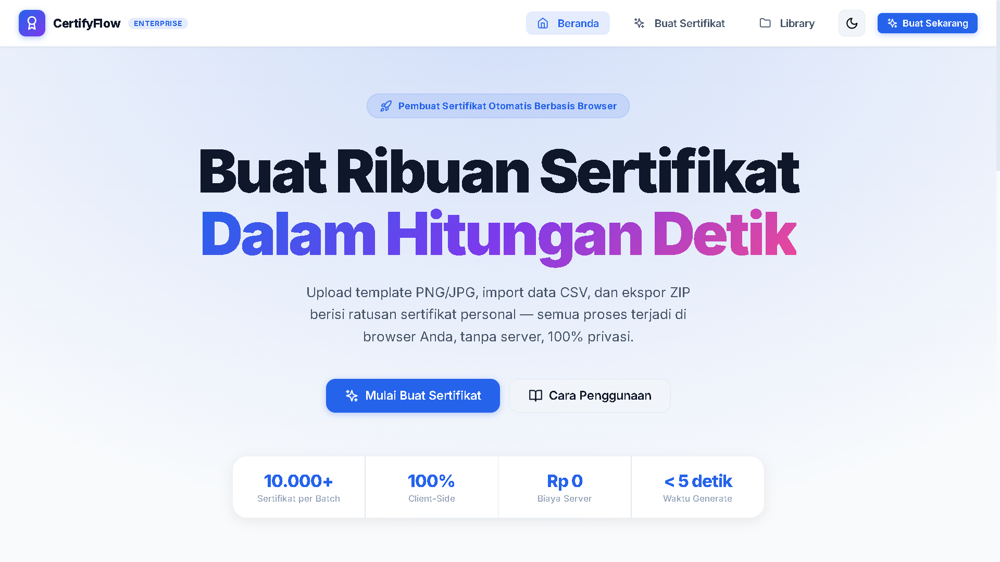
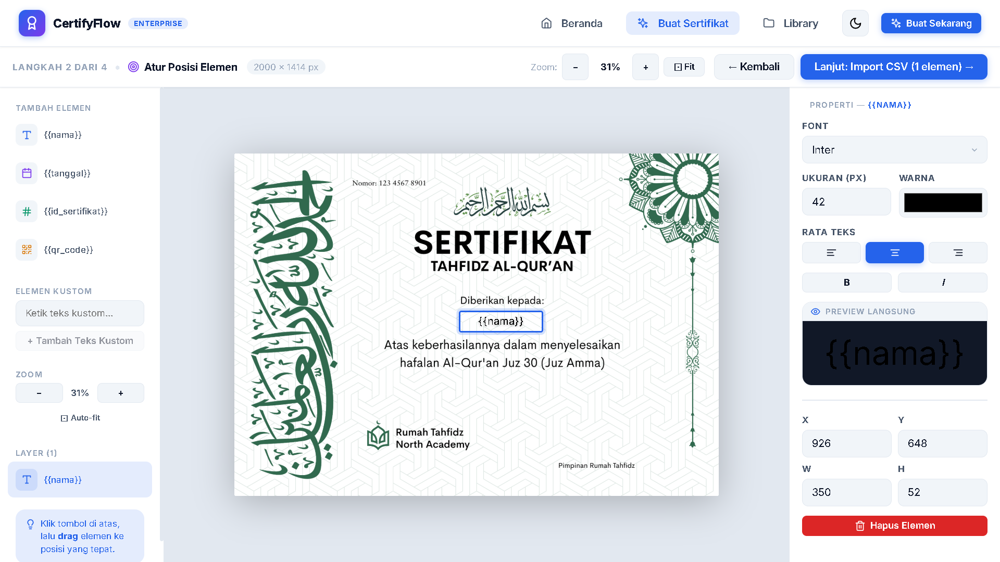

<div align="center">

# 🏆 CertifyFlow Enterprise
**Platform Pembuat Sertifikat Massal Otomatis — 100% Client-Side & Zero-Server**

[](./LICENSE)
[](https://nextjs.org/)
[](https://www.typescriptlang.org/)
[](https://react.dev/)
[](./CONTRIBUTING.md)

<p align="center">
  Buat ratusan hingga ribuan sertifikat personal dalam hitungan detik. Upload template PNG/JPG, import CSV data penerima, atur posisi elemen visual dengan drag & drop, dan ekspor langsung ke file ZIP atau PDF multi-halaman tanpa mengirim data ke server manapun.
</p>

<p align="center">
  <a href="https://certifyflow.exatemplate.com/" target="_blank" rel="noopener noreferrer">
    🌐 Kunjungi Web CertifyFlow
  </a>
</p>

</div>

<div align="center">
  
</div>

<div align="center">
  
</div>

---

## 🌟 Fitur Utama

- 🔒 **100% Client-Side & Privasi Penuh** — Seluruh data penerima dan template diproses langsung di browser lokal Anda. Tanpa backend API, tanpa pelacakan, dan aman untuk data sensitif.
- 🎨 **Visual Canvas Editor** — Drag & drop posisi nama, tanggal, nomor sertifikat unik, teks kustom, dan QR code langsung di atas template gambar.
- 🔤 **Google Fonts & Tipografi Fleksibel** — Kustomisasi ukuran font, warna, perataan (kiri, tengah, kanan), ketebalan (bold), dan format miring (italic) dengan live preview instan.
- 📊 **Import CSV & Pemetaan Kolom Fleksibel** — Upload file CSV berisi ribuan baris, lalu petakan kolom secara visual ke variabel sertifikat. Dilengkapi tombol unduh template CSV contoh.
- 📦 **Pilihan Ekspor Fleksibel**:
  - `ZIP-PNG` (File gambar individual kualitas tinggi)
  - `ZIP-PDF` (File dokumen PDF individual per penerima)
  - `SINGLE-PDF` (Satu dokumen PDF multi-halaman gabungan seluruh sertifikat)
- 🗂️ **Library Template Lokal (IndexedDB)** — Simpan template favorit langsung di memori browser untuk digunakan kembali kapan saja.
- ⚡ **Multi-thread Batch Generator** — Mengoptimalkan performa browser untuk menghasilkan ribuan sertifikat secara simultan tanpa membuat browser hang.
- 🌐 **Offline First** — Berjalan mulus tanpa koneksi internet setelah halaman web dimuat.

---

## 🚀 Memulai (Quick Start)

### Prasyarat
- [Node.js](https://nodejs.org/) (versi 18 ke atas)
- npm / yarn / pnpm

### Instalasi & Menjalankan

```bash
# 1. Clone repository
git clone https://github.com/USERNAME/certifyflow.git
cd certifyflow

# 2. Install dependensi
npm install

# 3. Jalankan server development lokal
npm run dev
```

Buka **[http://localhost:3000](http://localhost:3000)** di browser Anda.

---

## 🚀 Deploy ke Vercel

1. Push repository ke GitHub, lalu import repository tersebut di [Vercel](https://vercel.com/new).
2. Biarkan framework preset **Next.js** dan build command default (`npm run build`).
3. (Disarankan) Tambahkan environment variable `NEXT_PUBLIC_SITE_URL` dengan URL produksi, misalnya `https://certifyflow.example.com`, untuk semua environment yang akan dipakai.
4. Deploy. Build akan menghasilkan static site di folder `out`, termasuk `robots.txt` dan `sitemap.xml`.

Tanpa `NEXT_PUBLIC_SITE_URL`, build Vercel menggunakan URL produksi/proyek Vercel yang tersedia. Untuk build lokal tanpa URL, situs tetap bisa dibangun, tetapi sitemap tidak dihasilkan sampai URL dikonfigurasi.

---

## 📖 Cara Penggunaan (4 Langkah Mudah)

Akses menu **Buat Sertifikat** atau buka **[http://localhost:3000/wizard](http://localhost:3000/wizard)**:

1. **Upload Template**:
   - Upload file template sertifikat Anda (format PNG atau JPG).
   - Ukuran rekomendasi: A4 Landscape (`3508×2480 px`) atau A4 Portrait (`2480×3508 px`).
   - Anda juga dapat memilih template yang sudah tersimpan di **Library**.
2. **Atur Posisi Elemen**:
   - Tambahkan elemen teks variabel: `{{nama}}`, `{{tanggal}}`, `{{id_sertifikat}}`, `{{qr_code}}`, atau teks kustom bebas.
   - Pindahkan posisi dengan drag & drop di atas canvas.
   - Atur font, ukuran, warna, dan perataan di panel properties.
3. **Import Data CSV**:
   - Upload file CSV berisi daftar penerima sertifikat.
   - Petakan variabel template ke header kolom file CSV.
4. **Generate & Download**:
   - Pilih format ekspor yang diinginkan (`ZIP-PNG`, `ZIP-PDF`, atau `SINGLE-PDF`).
   - Klik **"Mulai Generate"** dan unduh file hasil kemasan.

---

## 📁 Struktur Direktori

```text
certifyflow/
├── src/
│   ├── db/
│   │   └── index.ts          # Skema IndexedDB (Dexie.js)
│   ├── hooks/
│   │   ├── useBatchProcessor.ts
│   │   └── useIndexedDB.ts   # Hook manajemen penyimpanan lokal
│   ├── lib/
│   │   ├── pdf-builder.ts    # Komposisi PDF dengan pdf-lib
│   │   ├── qrcode.ts         # Pembuat QR Code
│   │   └── utils.ts          # Utility functions
│   ├── pages/
│   │   ├── index.tsx         # Landing page & panduan
│   │   ├── storage.tsx       # Library template & riwayat batch
│   │   └── wizard.tsx        # Wizard 4 langkah generator
│   ├── styles/
│   │   └── globals.css       # Design system tema gelap/terang
│   ├── types/
│   │   └── certificate.ts    # TypeScript definitions
│   └── workers/              # Multi-threading Web Workers
├── public/                   # Asset statis & favicon
├── .github/                  # Template Issue & Pull Request
├── CONTRIBUTING.md           # Panduan kontribusi open source
├── CODE_OF_CONDUCT.md        # Pedoman kode etik komunitas
├── SECURITY.md               # Kebijakan pelaporan keamanan
├── LICENSE                   # Lisensi open source (MIT)
└── package.json
```

---

## 🛠️ Tech Stack

| Teknologi | Fungsi |
|-----------|--------|
| **[Next.js 14](https://nextjs.org/)** | React Framework untuk UI |
| **[TypeScript](https://www.typescriptlang.org/)** | Type safety & maintainability |
| **[Dexie.js](https://dexie.org/)** | Wrapper IndexedDB untuk penyimpanan lokal template |
| **[PapaParse](https://www.papaparse.com/)** | Parser CSV ultra-cepat di browser |
| **[pdf-lib](https://pdf-lib.js.org/)** | Pembuatan dokumen PDF di sisi klien |
| **[JSZip](https://stuk.github.io/jszip/)** & **[FileSaver.js](https://github.com/eligrey/FileSaver.js)** | Kompresi arsip ZIP dan pemicu download |
| **[QRCode](https://github.com/soldair/node-qrcode)** | Generator QR Code client-side |

---

## 🤝 Kontribusi

Kontribusi selalu disambut dengan hangat! Baik dalam bentuk perbaikan bug, usulan fitur baru, penambahan font/template, maupun perbaikan dokumentasi.

Silakan baca **[CONTRIBUTING.md](./CONTRIBUTING.md)** untuk alur kerja dan panduan Pull Request, serta **[CODE_OF_CONDUCT.md](./CODE_OF_CONDUCT.md)** untuk kode etik komunitas kami.

---

## 📄 Lisensi

Proyek ini dilisensikan di bawah lisensi terbuka **[MIT License](./LICENSE)**. Anda bebas menggunakan, memodifikasi, dan mendistribusikan proyek ini untuk keperluan pribadi maupun komersial.
